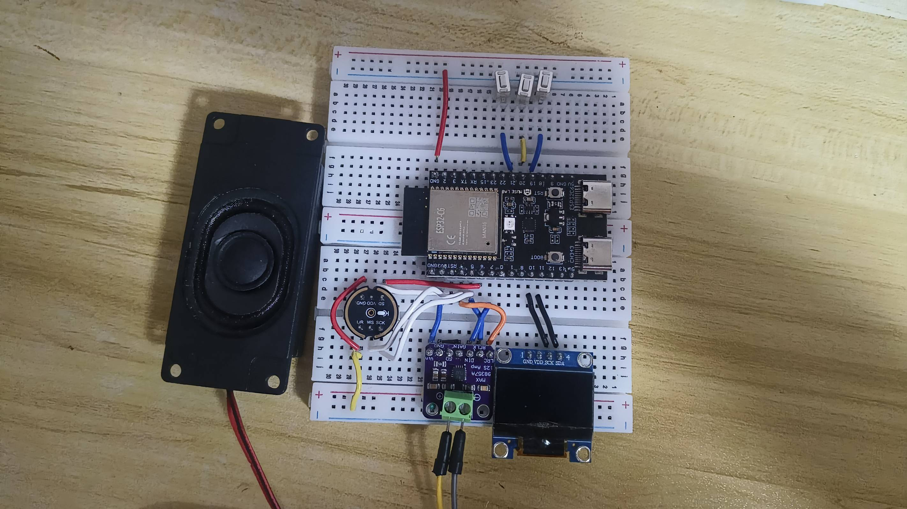
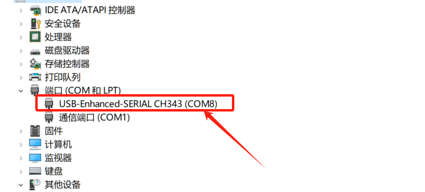
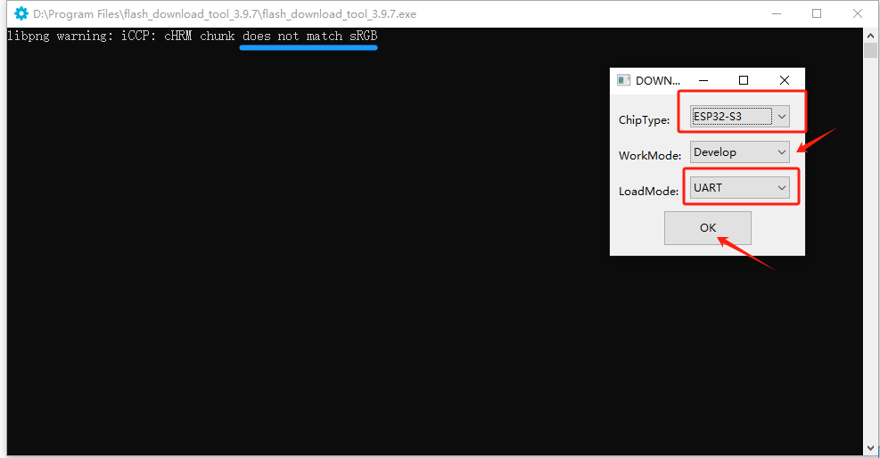
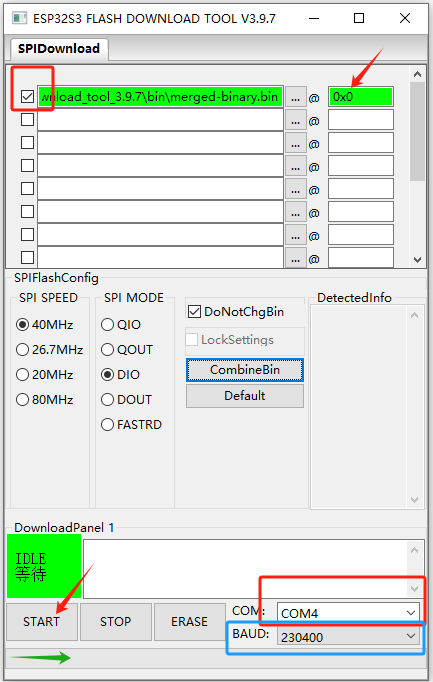
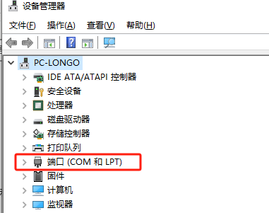
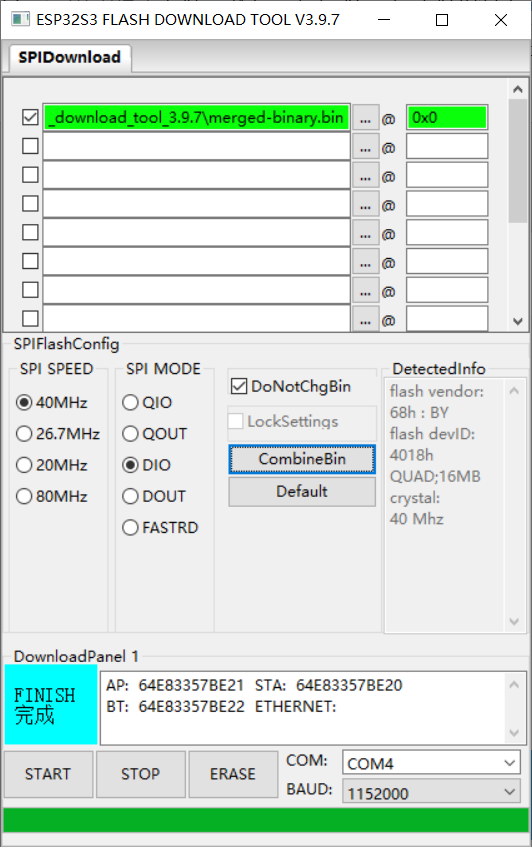

# 教程一 · 小智 AI 语音助手（ESP32-C6 + OLED + 麦克风 + 功放）

> 做一台能联网对话的桌面语音助手。按一下按钮配网，OLED 显示表情，说句话它就回答。

**难度** ★★☆☆☆
**硬件成本** 约 ¥80
**动手时间** 约 2 小时
**成品** 一块能听懂人话、能显示表情、能开口回答的桌面 AI 助手

这一篇是基础篇。后面的[机器狗教程](02-xiaozhi-dog.md)是在**同一块板子、同一份固件**
上再加外设。

**这篇不用写代码，也不用装编程环境。** 全部照着点就行。

跟着做的大致流程：

```
①看成品 → ②备材料 → ③接线 → ④烧固件 → ⑤配网 → ⑥看它跑起来
```

卡住了直接跳[第 7 章 常见问题](#7-常见问题)。

---

## 1. 做完是什么样

```
┌────────────────────────────────────┐
│  ┌────────┐                🔴 LED  │
│  │ OLED   │      ESP32-C6           │
│  │ 128×64 │      (面包板)│
│  └────────┘                         │
│    ↑I2C              [BOOT]         │
│  GPIO10/11                           │
│                                     │
│  🎤麦克风 ──I2S──► ESP32            │
│  ESP32 ──I2S──► 🔊 MAX98357A 功放   │
└────────────────────────────────────┘
```

做完之后它能做到：

- 按一下 BOOT 键连 Wi-Fi，用微信「小智 AI」小程序配网
- 联网后 OLED 显示表情，说唤醒词就能开始对话
- 你说话 → 云端AI 处理 → 功放把回答播出来
- OLED 实时显示它在听、在想、在说什么
- 板子上三个按键：音量减、音量加、说话

---

## 2. 材料清单

### 2.1 要买的东西

| 东西 | 买的时候怎么说 | 数量 | 大概钱 |
|---|---|---|---|
| 主控板 | **ESP32-C6 面包板开发板** | 1 | ¥25 |
| OLED 小屏 | **SSD1306 128×64，四脚 I2C 版** | 1 | ¥8 |
| 数字麦克风 | INMP441，I2S 接口，五根线 | 1 | ¥6 |
| 功放模块 | MAX98357A，I2S 接口 | 1 | ¥6 |
| 小喇叭 | 4Ω 3W 左右| 1 | ¥5 |
| 面包板 | 半幅就够| 1 | ¥5 |
| 杜邦线 | 公对母 + 公对公 | 一把 | ¥5 |
| Type-C 数据线 | **要能传数据的，不是只充电的** | 1 | 你有就有 |

> **总共约 ¥60~80**，一次买齐。

### 2.2 ★ 买之前一定要看这两条

**第一条：OLED 要买「四脚」的，别买「七针」的。**

这是最容易踩的坑。四脚版只有 4 个针脚：`VCC / GND / SDA / SCL`。
七针版有 7 个（多出 CS / RES / DC），是另一种协议，**插上去完全没反应**，
而且外表看起来几乎一样，很容易买错。

**第二条：主控板要认准「ESP32-C6 面包板」。**

固件里对应的是`bread-compact-c6` 这一款：ESP32-C6 焊在小面包板上，
引脚全引出来了，还带 BOOT / RST 键和三个小按键。

如果你手里是普通 ESP32-C6 开发板（DevKitC 那种大板子），**引脚对不上，
第3 章的接线表不能照抄**。

### 2.3 工具

- 装了 Windows / macOS / Linux 的电脑
- 一根能传数据的 Type-C 线（烧录用）
- 万用表（可选，但建议有 —— 防短路）

---

## 3. 接线

> 🔌 **这一章最关键，接错了后面全白搭。**
> 慢一点，接一根查一根。

### 3.1 先认清面包板

面包板上有个「凹槽」（中间那条断开的长沟），板子就插在凹槽上。

记住两条规则，后面全靠它：

- **凹槽左右两半是不通的**
- **同一列（竖着一排的 5 个孔）是通的**

```
    ┌─────────────────────────────────┐
    │  ● ● ● ● ○ ○ ○ ● ● ● ● ●│  ← 上下都不通
    │  ● ● ● ● ○ ○ ○ ● ● ● ● ●
    │  ● ● ● ● ○ ○ ○ ● ● ● ● ●│  ← 同一列上下通
    │  ● ● ● ● ○ ○ ○ ● ● ● ● ●
    └─────────────────────────────────┘
          ╰────── 凹槽 ──────╯
     （凹槽左右两半互不相通，板子压在上面）
```

> 💡 不会数孔？**数丝印**。板子上每个引脚旁边都印着 `GPIO11` 这样的字，
> 照着字找比数孔靠谱得多。

### 3.2 接 OLED（4 根线）

OLED 模块上有 4 个针脚，看丝印接：

| OLED 上的丝印 | 接到板子的哪一脚 |
|---|---|
| `VCC` | `3V3` |
| `GND` | `GND` |
| `SDA` | **`GPIO11`** |
| `SCL` | **`GPIO10`** |

> ⚠️ **注意这里反直觉：SDA 接 11，SCL 接 10。**
>
> 很多人以为「左边 SDA、右边 SCL」，这里恰好相反。
> 而且这两个脚在板子上是挨着的，插反概率很高。
> **接的时候对着模块上的丝印一个字一个字对，别凭左右猜。**

> 💡 SDA 和 SCL 各并一个 **4.7kΩ** 电阻到 3V3会更稳。
> 没有也能跑，先不装；屏不稳的时候再回来加。

### 3.3 接麦克风（5 根线）

INMP441 这类数字麦克风有 5 根线：

| 麦克风上的丝印 | 接到板子的哪一脚 |
|---|---|
| `VDD` | `3V3` |
| `GND` | `GND` |
| `SCK` | `GPIO5` |
| `WS` | `GPIO4` |
| `SD` | `GPIO6` |

### 3.4 接功放和喇叭（6 根线）

MAX98357A 功放模块：

| 功放上的丝印 | 接到板子的哪一脚 |
|---|---|
| `VIN` | `3V3` |
| `GND` | `GND` |
| `BCLK` | `GPIO5` ← **和麦克风共用** |
| `LRC` | `GPIO4` ← **和麦克风共用** |
| `DIN` | `GPIO7` |
| `SD`（静音脚） | **`3V3`** ← 硬接高电平 |
| `GAIN` | 悬空不管 |

喇叭的两根线接到功放的 `SPK+` / `SPK-`（有些模块写 `OUT+` / `OUT-`）。

> ⚠️ **功放的 `SD` 必须接 3V3，不要接 GPIO21。**
> GPIO21 是「说话键」，接上去的话你按住说话的时候功放会静音。

> 💡 **为什么 GPIO4/5 上要接两根线？**
> ESP32-C6 只有一路 I2S，收发共用同一组时钟。所以麦克风的 `SCK/WS`
> 和功放的 `BCLK/LRC` 必须接在同一个脚上 —— 这不是接错，是设计如此。

### 3.5 三个按键不用你接

板子上已经焊好了三个小按键：

| 按键 | 干什么用的 |
|---|---|
| 音量减 | 调小音量 |
| 音量加 | 调大音量 |
| 说话 | 按住说话，松手它就开始回答 |

### 3.6 全表速查（照这个再检查一遍）

| 东西 | 接哪 | 备注 |
|---|---|---|
| OLED SDA | **GPIO11** | ⚠️ 不是 10 |
| OLED SCL | **GPIO10** | ⚠️ 不是 11 |
| OLED VCC / GND | 3V3 / GND | |
| 麦克风 SCK | GPIO5 | 和功放共用 |
| 麦克风 WS | GPIO4 | 和功放共用 |
| 麦克风 SD | GPIO6 | |
| 麦克风 VDD / GND | 3V3 / GND | |
| 功放 BCLK | GPIO5 | 和麦克风共用 |
| 功放 LRC | GPIO4 | 和麦克风共用 |
| 功放 DIN | GPIO7 | |
| 功放 SD | **3V3** | ⚠️ 别接 GPIO21 |
| 功放 VIN / GND | 3V3 / GND | |
| 喇叭 | 功放 SPK+ / SPK- | |

### 3.7 看一眼实物



*对照实物，重点确认三处：*

1. **OLED 在右下角**，是四脚的那块，插的是 SDA=11 / SCL=10 这一对
2. **麦克风和功放共用两根线**（GPIO4 和 GPIO5），所以你会看到三根线一起从C6拉过去
3. **功放的 SD 脚接的是 3V3**，不是按键

### 3.8 ★ 上电前检查一遍

按顺序打勾，全勾上再插 USB：

```
□ OLED 是四脚的，不是七针的
□ OLED 的 SDA 接了 GPIO11、SCL 接了 GPIO10（照丝印对，不是凭左右猜）
□ 功放的 SD 接了 3V3（不是 GPIO21）
□ 所有 GND 都接到了板子的 GND
□ 3V3 和 5V 没有被短接在一起
□ 用万用表量过 3V3 和 GND 之间没有短路
```

最后一条别省。**短路着插 USB 有可能烧板子**，就几秒钟的事，但不值得冒险。

---

## 4. 烧固件

### 4.1 先搞清楚要干什么

板子上没有固件就是个砖头。烧固件 = **把程序装进板子**。

这一步有两条路，**选一条就行，不用都做**：

| | 路线 A：先用命令烧（推荐） | 路线 B：用工具软件烧 |
|---|---|---|
| 怎么做 | 敲一行命令 | 点几下鼠标 |
| 适合谁 | 想少装东西 | 以后还要反复烧 |
| 需要准备 | 电脑装好 ESP-IDF | 乐鑫 Flash 下载工具 |

**先按路线 A 走通**，跑起来之后第 4.9 节会告诉你怎么改成路线 B ——
以后每次改固件，用工具软件点几下就行，比敲命令快得多。

### 4.2 装编译环境（只需装一次）

固件要自己编译，所以要先装 ESP-IDF。

去乐鑫官网下载对应你系统的安装包：

👉 <https://docs.espressif.com/projects/esp-idf/zh_CN/latest/esp32c6/get-started/index.html>

按里面的步骤装。Windows 用户装完，桌面会出现一个
**「ESP-IDF 命令提示符」** 快捷方式 —— **以后所有命令都在这个窗口里敲**，
普通 cmd / PowerShell 里是找不到命令的。

装完验证一下，在那个窗口里敲：

```bash
idf.py --version
```

能打印出版本号就说明装好了。C6 需要 **ESP-IDF 6.0.1 以上**（推荐 6.1）。

### 4.3 下载源码

```bash
git clone https://github.com/78/xiaozhi-esp32.git
cd xiaozhi-esp32
git checkout v2.5.2
```

> 💡 **为什么要指定版本？**
> 这个项目更新很快，不同版本的配置项名字会变。
> 不锁版本的话，你看到的报错多半是对不上文档，不是你做错了。

### 4.4 配置成你的板子

```bash
idf.py set-target esp32c6
idf.py menuconfig
```

会弹出一个菜单，按 `S` 搜索，按 `Y` 进子菜单。

要改的地方：

| 菜单项 | 选什么 |
|---|---|
| Xiaozhi Assistant → Board type | **`bread-compact-c6`** |
| Xiaozhi Assistant → Display → OLED | SSD1306 **128×64** |
| Audio codec（音频） | 按你 3.3 / 3.4 节实际接的线选 |

选完存盘退出（`S` 保存）。

### 4.5 编译

```bash
idf.py build
```

要等几分钟。**成功的标志是看到这两行**：

```text
BUILD_EXIT=0
Successfully created ESP32-C6 image.
```

> ⚠️ **别只看退出码。** 有时候输出被重定向，退出码会骗你。
> 就认上面那两行。

### 4.6 找到板子的串口

插上 USB 线，Windows 会多出一个 COM 口。

**端口号每次可能不一样**，所以别记死。用下面这行命令找：

```bash
python -m serial.tools.list_ports -v
```

找带 `1A86:55D3` 的那一行（`1A86` 是沁恒的芯片厂代码）：

```text
COM<n>  | USB-Enhanced-SERIAL CH343 | USB VID:PID=1A86:55D3
                        ↑ 记下这个端口号
```

不认识命令的话，**用设备管理器找也行**：



*图：设备管理器 → 端口（COM 和 LPT）→ 找带 `CH343` 的那一项，
它后面的括号里就是你的端口号。*

> ⚠️ Windows 上COM3、COM5、COM9 这类小号通常是**蓝牙虚拟口**，没有真实设备。
> 往这些口烧会安静地空等然后超时。
>
> 认不准就拔掉再插上，看哪个口消失又冒出来，那个就是。

### 4.7 ★ 让板子进入下载模式

**这是最容易卡住的一步。**

这块板子配的串口芯片不支持自动复位，直接烧会一直等到超时。要手动操作：

```
1. 按住 BOOT 键  不放
2. 点一下 RST 键
3. 松开 RST
4. BOOT 继续按住，约 2 秒
5. 松开 BOOT
```

做完马上进行下一步。**别等太久**，放太久会自动重进正常模式。

### 4.8 烧录

把 `<COM11>` 换成 4.6 步记下的端口号：

```bash
idf.py -p <COM11> flash
```

等它烧完，然后烧录状态下再点一次 `RST`，板子就启动进固件了。

**判断成功**：按 `RST` 之后 OLED 亮起来，或者用 4.9 的方法能看到日志输出。

### 4.9 ★ 以后都用工具软件烧（更省事）

上面那套每次都要敲命令。**其实编译完之后只需要烧一个文件**，
用乐鑫的图形工具烧更方便，也更适合手抖的人。

**第一步：打包成一个 bin 文件**

编译完之后（在 ESP-IDF 窗口里）敲：

```bash
python scripts/release.py
```

跑完在 `build/` 目录下会出现 **`merged-binary.bin`** —— 这就是你要烧的东西。
（如果这步报「zip」相关的错，**忽略**，只要文件在就行。）

**第二步：下载烧录工具**

去乐鑫官网下Flash 下载工具 3.9.7：

👉 <https://www.espressif.com.cn/zh-hans/support/download/other-tools>

解压后不用安装，双击里面的 `flash_download_tool_3.9.7.exe` 就能开。

> ⚠️ **工具和固件都别放在中文文件夹里**（比如「我的固件\下载」这种），
> 会加载失败。这是很常见的翻车点。放一个纯英文的路径就行。

**第三步：设芯片型号**

打开工具后先弹一个小窗，按下面选：



| 项目 | 选什么 |
|---|---|
| ChipType（芯片型号） | **`ESP32-C6`** |
| WorkMode | `Develop` |
| LoadMode（下载模式） | **`UART`** |

选完点 `OK`。

> 💡 上图是官方文档里 ESP32-S3 的截图，**你要把芯片型号换成 ESP32-C6**。
> 工具本身长得一样。

**第四步：把 bin 装进去**

主界面里，第一行找到空白的文件名框：



三件事：

1. 点 `...` 选到你的 `merged-binary.bin`
2. **把左边那个勾选框打上** ← **不打勾就完全不烧，最常见的错**
3. 右边的地址框填 **`0x0`**

**第五步：选串口**

在下面 `DownloadPanel 1` 那块，`COM:` 下拉框里选 4.6 步记下的端口号。



如果下拉框里是空的，说明板子没被认到 —— 回去检查 USB 线是不是只充电不传数据。

**第六步：烧**

点 `START`。等进度条走完，右下角出现绿色的 **`FINISH 完成`** 就算好了。



> 💡 烧录过程中如果弹出 `libpng warning` 或者找不到 sRGB 灯之类的警告，
> **不影响烧录，忽略就行**（有些板子本来就没焊那个灯）。

**第七步：重启**

烧完点工具上的 `RST`（或直接按板子的 RST 键），板子就进固件了。

> 📌 **两种烧法怎么选？**
> - 只是想赶紧跑起来 → 一直用 4.8 的`idf.py flash`，一条命令搞定
> - 以后要反复改固件烧（做机器狗那篇时就是这样）→ 用 4.9 的工具，
> 改完编译 → 跑一次 `release.py` → 点几下烧完，不用记偏移地址

### 4.10 看日志（可选，但很有用）

想知道板子在干什么，可以看实时日志：

```bash
idf.py -p <COM11> monitor
```

按 `Ctrl + ]` 退出。

> 抓不到完整日志？见[第 7 章](#7-常见问题)里的说明。

---

## 5. 配网

第一次用要告诉它「你的 Wi-Fi 密码是多少」。

1. **长按 BOOT 键**约 3 秒
2. 屏幕提示进入配网
3. 用**微信「小智 AI」小程序**扫码连Wi-Fi

> ⚠️ **不要用浏览器打开配网页面。**
> 实测踩过：浏览器扫码跳转后一片空白，代码和接线都正常，换小程序就好了。

配网成功后它会自己连上，之后开机会自动联网，不用再配。

---

## 6. 怎么确认成功了

### 6.1 一步步试

按顺序做，每一步都该有明确反应：

| # | 你做什么 | 应该看到什么 |
|---|---|---|
| 1 | 看 OLED | 有画面（表情或文字），不是一直黑屏 |
| 2 | 说唤醒词 | OLED 状态变化，喇叭出声 |
| 3 | 说一句完整的话 | 它回答，OLED 显示对话内容 |
| 4 | 按音量加 / 减 | 音量有变化 |
| 5 | 按住说话键说话 | 松开后它开始回答 |

### 6.2 日志里认这几个词

用4.10 的命令看日志，应该从上到下依次看到：

```text
SKU=bread-compact-c6                    ← 板型识别对了
Duplex channels created                 ← 麦克风和功放都起来了
Certificate validated                   ← 网络正常
Activation successful                   ← 设备激活成功
OLED IS LIVE                            ← 屏幕点亮了
```

| 看到这行 | 说明 |
|---|---|
| `SKU=bread-compact-c6` | 板型配对了 |
| `Duplex channels created` | 音频通道建起来了 |
| `Certificate validated` | 网络正常 |
| `OLED IS LIVE` | 屏亮了 |
| `Activation successful` | 激活成功 |

---

## 7. 常见问题

### 7.1 烧录阶段

| 你遇到的 | 为什么 | 怎么办 |
|---|---|---|
| `idf.py: 不是内部或外部命令` | 环境没装，或没在对的窗口里 | 用桌面那个「ESP-IDF 命令提示符」快捷方式，别用普通 cmd |
| 一直等到超时 | 没进下载模式 | 重新按 4.7 手动进模式再来一次 |
| 还是超时 | 端口号认错了 | 按 4.6 重新用 VID:PID 认，别用猜的号 |
| `Failed to connect` | 端口是蓝牙虚拟口 | 同上 |
| 编译报找不到板型 | 版本不对 | 确认 `git checkout v2.5.2` 执行过 |
| 工具里勾了还是没烧进去 | 忘了打勾选框 | bin 文件左边那个框必须打勾 |
| 工具加载不了 bin | 路径里有中文 | 把文件和工具都移到纯英文路径 |
| 编译看着失败了但其实没有 | 输出被重定向，退出码骗人 | 认 `Successfully created ESP32-C6 image.` 这行 |

### 7.2 上电后没反应

| 症状 | 先查这个 |
|---|---|
| 板子完全没反应 | 万用表量3V3 有没有电压；USB 线是不是只充电不传数据 |
| 日志停在最开头 | 复位键按住不放试试 |
| OLED 一直黑 | 见 [7.3](#73-屏幕黑屏) |
| 完全没声音 | 功放 `SD` 接 3V3 了吗；喇叭接 `SPK+/SPK-` 了吗 |
| 有声音但听不清 | 喇叭阻抗对不对（要 4Ω 或 8Ω） |
| 能联网但不收音 | 麦克风 `SD` 接 GPIO6、`SCK` 接 GPIO5 了吗 |
| 一开机就反复重启 | 供电不够，换根好点的 USB 线 |

### 7.3 屏幕黑屏

这是最高频的问题。**先别怀疑屏坏了**，按顺序查：

**第一步，等 5 秒再看。**

SSD1306 的内部电路要约 3 秒才准备好。**刚上电等两三秒才亮是正常的，不是坏了。**
等够 5 秒还全黑，继续往下。

**第二步，看日志里有没有这行：**

```text
OLED WATCH: still no ACK
```

它反复出现 → 屏在应答但不成功；不打 → 固件压根没去探它。

**第三步，用万用表量电压：**

| 量到 | 说明 |
|---|---|
| 3V3 正常（约 3.3V） | 供电没问题 |
| SDA/SCL 在 0.6~0.7V 之间飘 | **屏没供电**，去查 OLED 的 VCC 线 |
| 3V3 只有 2.6~2.7V | 供电本身不够，换电源 |

> ⚠️ 那个 0.6~0.7V 特别容易误判成「屏在工作」。它其实是**屏没供电**的信号。

还是不行 → 去查[排查手册](03-troubleshooting.md)，里面有更细的手段。

### 7.4 抓不到完整日志

CH343 芯片有个老毛病：收到复位脉冲后会断流，只能抓到开头一小段。

| 问题 | 怎么办 |
|---|---|
| 管道里抓不到 | 把输出存成文件再筛 |
| 反复调复位来不及重新识别 | 烧录完**立刻**开始监听 |
| 开一次端口只能抓一轮 | 一次开端口，循环按 RST 抓多轮 |

---

## 8. 做完之后

- 能对话了 → [教程二 · 小智机器狗](02-xiaozhi-dog.md)，在这套基础上加四条腿
- 卡住了 → [教程三 · 外设不工作怎么查](03-troubleshooting.md)
- 想回退固件 → 见 [8.1](#81-存个存档)

### 8.1 存个存档

**这一步认真做**，下一篇要改固件，改完得能退回来。

```bash
cd xiaozhi-esp32
git add -A && git commit -m "语音助手已跑通"
git tag baseline-ai-working          # ← 关键

git checkout -b feature-dog          # 下一篇在这个分支上做
```

> ⚠️ **回退固件就走 git，不要用 `read_flash` 读回来重刷。**
>
> 实测过：全片4MB 读取极不稳定（串口丢字节），读回来的镜像不含
> bootloader 和分区表，只能应急参考。而 git 一个tag 就够了，
> 回退的还是**完整可修改的源码**。

---

# 附录：原理与排查

> 前面八节是动手主线，照着走就能做完。下面是主线里压缩掉的原理，
> **卡住了再回来读**，不影响你做出来。

## 附录 A：屏幕为什么会晚亮约 3 秒

同一个探测程序，换不同时间点跑，结果完全不同：

| 探测时机 | 结果 |
|---|---|
| 启动时立即探 | 全 miss |
| 延时 600ms | 全 miss |
| 延时 2500ms | 仍全 miss |
| 运行几秒后（后台任务里探） | **稳定 HIT** |

**根因：SSD1306 的内部电荷泵上电极需要时间建立。**
屏物理上是好的，只是应答之前内部还没准备好。实测稳定命中的时刻是**约 2.9 秒**。

所以固件改成「启动不等屏」：启动时快速探一次，探不到就不管它，
另起一个后台任务每 2 秒重试，探到了再挂上去。

### A.1 为什么不能直接换指针

一开始的做法是：探测到屏 → 把 `display_` 指针从 `NoDisplay` 换成真屏。

**症状：屏闪一下，然后一直黑。**

原因是 `Application::Initialize()` 会把 `board.GetDisplay()` **缓存成一个局部指针**，
之后所有绘制都用那个缓存。运行期换掉指针之后，**没人再往新屏里画东西了**。
那一闪是驱动初始化时刷了一帧 RAM，之后就没人管它。

**看起来像屏坏了，其实是没人再往里画东西。**

正确解法是代理对象，指针终身不变：

```cpp
class DeferredDisplay : public Display {
    // 缓存最后一次被要求显示的状态
    std::string last_status_, last_emotion_, last_chat_role_, last_chat_content_;

    void Attach(Display* real) {
        real_ = real;
        real_->SetupUI();               // 按顺序重放缓存的状态
        real_->SetStatus(last_status_);
        real_->SetEmotion(last_emotion_);
        real_->SetChatMessage(last_chat_role_, last_chat_content_);
    }

    // 所有 Set* 方法都转发给 real_；没有 real_ 就先存进缓存
};
```

**核心：`display_` 整个生命周期只赋值一次，永远指向 `DeferredDisplay`。**

这个模式适用于任何需要延迟或异步初始化的外设：屏幕、音频 codec 芯片、
任何「开机时还不存在、之后才会出现」的东西。

## 附录 B：ESP-IDF 6.1 上的三个坑

如果你用的是 **6.1**，遇到下面三个问题不是你配置错了，是 IDF 本身的问题。
用 5.4 或某些厂商 fork 可能不受影响。

### B.1 `esp_crt_bundle` 越界崩溃

**现象**：TLS 证书校验时崩溃，`MCAUSE 0x2`，栈在 TLS 层。

**解法**：关掉交叉签名校验

```
CONFIG_MBEDTLS_CERTIFICATE_BUNDLE_CROSS_SIGNED_VERIFY=n
```

### B.2 I2C 总线销毁会导致悬垂指针

6.1 的 `i2c_del_master_bus()` 内部只置空了自己的局部副本，
调用方手里的指针变成悬垂指针，紧接着再建 bus 就 `Load access fault`。

**结论：6.1 没有公开的 bus 销毁 API，也没有 GPIO 交换 API。
运行期想换 SDA/SCL 不可行 —— 要换接线只能改配置文件重新编译。**

### B.3 I2C 跑 50kHz 会让设备卡死

I2C master 跑在 50kHz 时日志断在探测中途，之后无任何输出。
**速率只用 400kHz 或 100kHz。**

另外 `esp_lcd_panel_io_tx_param(panel_io_, 0xAE, NULL, 0)` 会触发 `abort()` ——
6.1 的 i2c master 内部有 `ESP_ASSERT` 拦截空数据指针。
改成传单字节缓冲，或直接跳过这条命令。

## 附录 C：几次误判

排屏幕问题的时候，下面这些假设全部是错的：

| 曾经的怀疑 | 实际情况 | 靠什么推翻的 |
|---|---|---|
| SDA / SCL 接反了 | **接线从头到尾都是对的** | 万用表 + 实测 |
| OLED VCC 虚焊 | 量到 2.67V 属正常，屏能应答就是好的 | 应答成功 |
| 地址是 0x3D 不是 0x3C | **真实地址就是 0x3C** | 长时间复测 |
| 供电不稳导致崩溃 | 崩溃点每次固定在同一行 | 栈回溯 |
| 板子烧坏了 | 能播报、联网、激活、屏能亮 | 功能实测 |

**共同点：所有「硬件/环境坏了」的怀疑，最后都被日志或一次简单测量推翻了。**

> 如果你现在正在怀疑自己的硬件，先读完
> [排查手册](03-troubleshooting.md) 的「几条铁律」再动手。

## 附录 D：速查

```bash
# 编译（认这两行：BUILD_EXIT=0 + Successfully created ESP32-C6 image.）
idf.py build

# 打包出 merged-binary.bin（报错里的 zip 提示可以忽略）
python scripts/release.py

# 烧录（先手动进下载模式：按住 BOOT → 点 RST → 松 RST → 继续按 BOOT 2 秒 → 松）
idf.py -p <COM11> flash

# 复位进固件
idf.py -p <COM11> monitor

# 找串口（认 VID:PID，不认端口号）
python -m serial.tools.list_ports -v
# CH343 特征：USB VID:PID=1A86:55D3

# 回退固件
git checkout baseline-ai-working && idf.py build && idf.py flash
```

## 附录 E：还能优化的地方

1. **补 I2C 上拉电阻** —— 加 4.7kΩ 到 3V3，别只依赖 ESP32 内部弱上拉
2. **清理诊断日志** —— OLED 探测的日志可以降级，重试次数可以精简
3. **换 128×32 屏** —— 改配置即可，其余不动