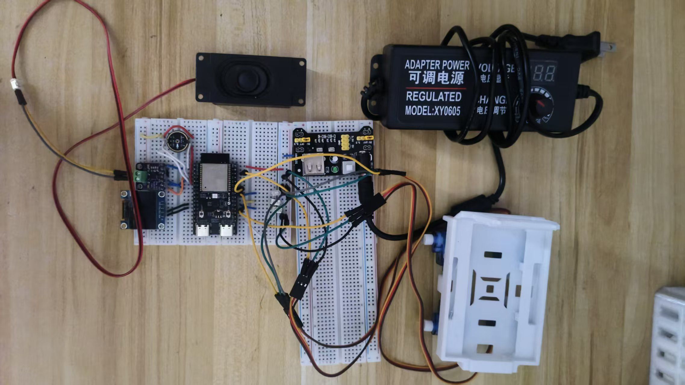

# 教程二 · 小智机器狗（ESP32-C6 + 4 × SG90 舵机）

> 给已经能说话的小智装上四条腿，让它听得懂「坐下」「趴下」并真的动起来。

**难度** ★★★★☆
**硬件成本** 约 ¥120（4 个舵机 + 独立电源）
**动手时间** 约 4 小时
**成品** 说"趴下"它就趴下，说"摇摇身子"它会摇

> **前置条件**：[教程一](01-xiaozhi-ai.md) 已经做完，固件能正常对话。
> 这一篇是在同一块板子、同一份固件上**加外设**，不是从零开始。

动手顺序：

```
① 看成品   →   ② 备材料   →   ③ ★接供电   →   ④ 接舵机   →   ⑤ 改代码
           →   ⑥ 烧录   →   ⑦ 验收   →   ⑧ 常见问题
```

> ⚠️ **接舵机前请先读完第 3 节。** 舵机是全教程唯一会烧硬件的地方，
> 供电接错一次可能烧掉板子。后面那几节写代码的部分都可以慢慢来，这节不行。

---

## 1. 做完是什么样

- 语音指令 → AI 判断语义 → 调用 MCP 工具 → 舵机执行动作
- **14 个语义动作**：站立 / 坐下 / 趴下 / 睡觉 / 鞠躬 / 警觉 / 摇身 /
  举左手 / 举右手 / 前进 / 后退 / 左转 / 右转 / 唤醒
- 对话时可以用软件偏置微调四条腿的机械对齐，不用拆机械

```
        🔊 小智：能说话
         │
    ┌────┴────┐
    │ ESP32-C6│
    └────┬────┘
  GPIO3/18/22/23
    │  │  │  │
   ╭╯  ╰╮ ╭╯  ╰╮
  RF   RB LF   LB        ← 4 × SG90，机械臂当腿
```

**这个形态是四足、每条腿一个自由度 —— 只做髋部摆动，不做真步行。**

这是有意的取舍：4 自由度 × 4 腿的逆运动学对舵机精度和机械结构要求很高，
而这个形态已经足够好玩，而且**不会因为相位没对齐就摔**。

---

## 2. 材料清单

### 2.1 必备件

| 物料 | 规格 | 数量 | 说明 |
|---|---|---|---|
| 主控板 | ESP32-C6 面包板开发板 | 1 | **复用教程一，不用新买** |
| OLED + 麦克风 + 功放 + 喇叭 | —— | —— | **同样复用** |
| 舵机 | SG90，180° 限位版 | 4 | |
| 外部电源 | 5V / **≥3A** DC 电源模块 | 1 | ★ 详见第 3 节 |
| 电解电容 | 1000µF，耐压 ≥10V | 1 | ★ 必装 |
| 面包板 | 复用 | 1 | |

### 2.2 工具

- 万用表 ×1（**这一篇比上一篇更需要它**，量电压要用）
- 螺丝刀 ×1（拧电源模块端子）
- 扎带或双面胶（固定电容和线束，可选）

### 2.3 ★ 买之前确认

**舵机买 180° 限位版。** 连续旋转版（有的叫 360°）没有角度概念，
你给多少脉宽它都只会朝一个方向转 —— 接上去表现是"一直嗡嗡转不停"。

---

## 3. ★ 接供电（动手前必读）

### 3.1 先算电流

| 项目 | 数值 |
|---|---|
| SG90 额定电压 | 4.8 ~ 6 V（**推荐 5.0 V**） |
| 静止电流 | 约 20~30 mA/个 |
| 堵转电流 | 约 300~600 mA/个 |
| **4 个同时动作最坏** | **~2.6 A** |

所以电源要 **≥3A**。

> ⚠️ **电压绝对不要超过 6V。** SG90 硬上限 6V，超过会烧内部芯片。
>
> **电压偏低反而更危险** —— 会触发模块内部限流，电机断续挣扎发出「嗡嗡」声。
> 这是很典型的欠压特征。看到嗡嗡声，第一反应是**量电压**，不是加阻力。

### 3.2 供电拓扑

这一节照着接，一根都不能少：

```
外部 5V 电源正 (≥3A)
    ├──→ 4 个舵机红线（并联，粗线直连，不经面包板）
    └──→ ESP32 的 5V/VIN          ← ★ 别忘了这个

外部 5V 电源负
    ├──→ 4 个舵机棕线（GND）
    └──→ ESP32 任意 GND           ← ★ 共地线，不能少

ESP32 GPIO3/18/22/23
    └──→ 4 个舵机的信号线（橙/白）
```

### 3.3 ★ 共地线是必须的

**PWM 脉冲的有效电平 = V(信号) − V(GND)。**

不共地时，两边各自浮动的参考电平会让舵机**完全收不到有效脉冲** ——
表现是「有电、有锁死阻力、但纹丝不动」。

> ⚠️ 这个症状和「信号线没插好」几乎无法从外部区分，是这一篇最容易误判的地方。

### 3.4 ★ 电容必装

1000µF 电解电容：**正极接 5V、负极接 GND，尽量靠近板子放。**

舵机堵转瞬间会把 5V 拽下去。没有电容的话 ESP32 会跟着掉电重启，
OLED 表现为「闪一下就黑」。

电容的作用是就近提供瞬时电流 —— **放得离板子远，退耦效果大打折扣。**

### 3.5 ★ 舵机不能走面包板电源轨

**面包板的载流上限约 1A**，4 个舵机最坏峰值 2.6A，绝对不能全走电源轨。

```
✗ 错误：舵机红线和 ESP32 都从面包板电源轨取电
        → 2.6A 峰值时轨上压降大，ESP32 跟着掉压

✓ 正确：舵机粗线直连电源正极（不经面包板）
        ESP32 从电源的另一路分支走
        两条分支只在"电源负极"汇合（共地点）
```

### 3.6 关于 USB 线

如果你打算拔掉 USB 独立运行，注意 USB 的三个作用：

| USB 的作用 | 拔掉会怎样 |
|---|---|
| 供电（5V → LDO → 3.3V） | **可以替代**：外部 5V 接板子 5V/VIN |
| 串口日志 | 丢失，看不到开机日志 |
| 烧录固件 | 无法烧录 —— 得先插 USB 烧完再拔 |

> ⚠️ **常见症状**：「必须插着 USB 屏才亮」。
>
> **这通常不是屏的问题** —— 是外部 5V 只接了舵机，ESP32 还在靠 USB 供电。
> 排查这个问题画供电拓扑图比读代码快得多：谁给谁供电，一目了然。

### 3.7 上电前检查清单

```
□ 舵机红/黑线没有走面包板电源轨（粗线直连）
□ ESP32 的 5V/VIN 接了外部电源（不只是舵机那路）
□ 所有 GND 汇到一处，有一根线接到 ESP32
□ 1000µF 电解电容已并联（正极 5V，负极 GND），且靠近板子
□ 外部电源电压 ≤ 6V（万用表量过，不是"大概 5V"）
□ 舵机臂不会撞到机械限位
□ 舵机信号线远离按键信号线，不交叉
```

**七条全过了再上电。**

---

## 4. 接舵机

### 4.1 四个舵机的位置

| 舵机 | 部位 | GPIO | 颜色约定 |
|---|---|---|---|
| 舵机 1 | 右前腿 RF | GPIO3 | |
| 舵机 2 | 右后腿 RB | GPIO18 | |
| 舵机 3 | 左前腿 LF | GPIO22 | |
| 舵机 4 | 左后腿 LB | GPIO23 | |

### 4.2 每个舵机三根线

SG90 一般是三根线，按颜色：

| 颜色 | 含义 | 接哪 |
|---|---|---|
| 棕 / 黑 | GND | 外部电源负 |
| 红 | +5V | 外部电源正 |
| 橙 / 白 / 黄 | 信号（PWM） | ESP32 对应 GPIO |

### 4.3 选脚依据

**为什么是这四个脚**：这块板子实际空闲的脚是 `GPIO3 / 14 / 15 / 18 / 22 / 23`，
四个舵机占了 3/18/22/23，**把 14/15 留着**给后续功能。

避开了所有禁区：

| 禁区 | 原因 |
|---|---|
| `GPIO24-30` | 内部 SPI flash，占用会启动失败 |
| `GPIO16-17` | UART0，调试输出 |
| `GPIO8` / `GPIO0` | strapping 脚，决定启动模式 |
| `GPIO1/2/4-7/9/10-11/19-21` | 教程一已经占用（音频、OLED、按键） |

### 4.4 ★ 左右镜像安装

左侧腿（3/4）与右侧腿（1/2）的**摆臂朝向要关于身体中轴线对称**。

代码里用 `right = 180 - left` 处理这个镜像关系。装的时候如果两条同侧的腿
朝同一方向转了，说明装反了，把其中一条的摆臂拆下来转 180° 再装回去。

### 4.5 看一眼实物



*图：机器狗整机接线实拍（俯视）。画面从上到下对应三层：*

- **最上方白色外壳**内是 SG90 舵机，棕/红/黑三色线束从这里下来
- **中层面包板**是 ESP32-C6 开发板（Wi-Fi 天线端朝左），PWM 信号线接在这里
- **下层面包板**是 OLED 屏、功放模块（带黑色散热片）和电解电容
- **画面左侧**那只黑色喇叭是独立接线的，不在面包板上

> ⚠️ **看这张图时留意**：舵机的电源线是从外部 5V 直接并联的，
> 板子上看不出来 —— 但少了这条共地线就会表现为「有电但不动」。

---

## 5. 改代码

> 到这一步已经过了最难的部分。下面的改动都是纯软件，改坏了能回退。

### 5.1 先建分支

```bash
cd xiaozhi-esp32
git checkout -b feature-dog
```

**动手前确认能回退**：

```bash
git checkout baseline-ai-working && idf.py build   # 回退测试
git checkout feature-dog                            # 回来继续
```

`config.h` 是所有外设引脚的**单一来源**，动它等于动整个板子。

### 5.2 加引脚宏

打开 `main/boards/bread-compact-c6/config.h`，加四行：

```c
#define SERVO_GPIO_1    3      // 右前腿
#define SERVO_GPIO_2    18     // 右后腿
#define SERVO_GPIO_3    22     // 左前腿
#define SERVO_GPIO_4    23     // 左后腿
```

### 5.3 新建控制器

新建文件 `main/boards/common/dog_leg_controller.h`（**只有头文件，没有 .cc**）。

**为什么用 header-only**：`main/CMakeLists.txt` 里 `boards/common/*.cc`
必须逐个显式列出（只有 `boards/${BOARD_DIR}/*.cc` 才用 `file(GLOB)`）。
加 `.cc` 就得改 CMakeLists；改 `.h` 就不会动构建系统，也不影响其他板型。
同款做法参考仓库里已有的 `lamp_controller.h`。

关键是这个换算函数：

```cpp
static constexpr uint32_t kDutyResBits = 20;
static constexpr uint32_t kServoPeriodUs = 20000;

uint32_t AngleToDuty(int deg) const {
    const int pulse_us = kPulseMinUs + (kPulseMaxUs - kPulseMinUs) * deg / 180;
    return (uint32_t)((uint64_t)pulse_us * (1UL << kDutyResBits) / kServoPeriodUs);
}
```

> ⚠️ **`duty` 不是微秒。** 这是本教程最贵的坑。
> 先读完[附录 A](#附录-aduty-不是微秒) 再往下写。

**再加一个调试开关**（`dog_leg_controller.h` 顶部）：

```c
#ifndef DOG_AUTO_CYCLE
#define DOG_AUTO_CYCLE 1    // 1 = 开机自动循环摆腿，0 = 只听指令
#endif
```

调舵机时置 1，上电会自动循环走 16 步姿态，
**这样不用依赖网络和语音就能看到硬件是否工作**。
调完记得改回 0。

### 5.4 注册

打开 `main/boards/bread-compact-c6/compact_c6_board.cc`：

```cpp
#include "dog_leg_controller.h"
```

在 `InitializeTools()` 里注册三个工具：

| 工具 | 参数 | 说明 |
|---|---|---|
| `self.dog.do_action` | `action`（必填）+ `repeat`（1-5） | 执行语义动作 |
| `self.dog.get_state` | 无 | 读当前姿态 |
| `self.dog.calibrate` | `op` + 腿 + 角度 | 在线标定 |

> ⚠️ **只暴露语义动作，不给 AI 裸角度。**
>
> AI 可能输出任何角度值，而 SG90 顶死机械限位会烧齿轮。
> 语义动作天然限制了取值范围 —— AI 只能说"趴下"，不能"转到 179 度"。

### 5.5 PWM 参数

| 参数 | 值 |
|---|---|
| 频率 | 50 Hz（周期 20ms） |
| 脉宽映射 | 500 µs = 0°，2500 µs = 180° |
| **硬限位** | **10° / 170°**（防堵转发热） |
| 实现 | LEDC，1 个 timer + 4 个 channel 共享时基 |
| 分辨率 | 20 位 → 一个计数 0.019µs，远超 SG90 需要的 5~10µs |

**上电先回 90° 中位，延时 ≥300ms 后再使能输出** ——
防止四个舵机同时猛冲到限位堵转发热。

### 5.6 姿态库

7 个姿态 + 14 个动作：

| 动作 | 语义 |
|---|---|
| `stand` | 站立 / 复位到 90° 中位 |
| `sitdown` | 坐下（前腿收起） |
| `lie` | 趴下 |
| `dosleep` | 睡觉 |
| `wake` | 唤醒 |
| `bow` | 鞠躬（AI 打招呼时） |
| `alert` | 警觉（被唤醒时） |
| `wag` | 摇身（兴奋时） |
| `raise_left` / `raise_right` | 举左手 / 右手 |
| `front` / `back` | 前进 / 后退 |
| `turn_left` / `turn_right` | 左转 / 右转 |

**动作之间用插值过渡**（每步 5°、步间 20ms），不是「写角度 + delay」的硬跳。
既保护齿轮，也更像真狗。

---

## 6. 烧录

先看这一条，然后照着教程一烧就行。

> ⚠️ **★ 舵机通电状态下不要烧录。**
>
> 烧录时板子会复位，舵机的信号线在这瞬间会失去确定电平。
> 运气好只是抖一下，运气不好会顶到限位堵转，电机和舵机都可能坏。
>
> **烧录前先把外部 5V 电源关掉，烧完再开。**
> 只插 USB 给板子供电是可以的。

### 6.1 两条路选一条

**路线 A：用命令烧（最省心）**

```bash
# 烧录前先关外部 5V 电源
idf.py build
idf.py -p <COM11> flash
```

手动进下载模式的按法、怎么找 COM 口，见
[教程一 4.6 ~ 4.8](01-xiaozhi-ai.md#46-找到板子的串口)。

**路线 B：用工具软件烧（推荐给你反复改固件的情况）**

这一篇要反复编译、反复烧。用图形工具比敲命令快：

```bash
idf.py build
python scripts/release.py      # 产出 build/merged-binary.bin
```

然后打开乐鑫Flash 下载工具，按 [教程一 4.9 节](01-xiaozhi-ai.md#49-以后都用工具软件烧更省事)
的六步走：芯片型号选 **`ESP32-C6`**、加载模式选 **`UART`**、
加载 `merged-binary.bin`、**勾上左边的勾选框**、地址填 **`0x0`**、选 COM 口，点 `START`。

> 📌 **两种烧法随时可以混用。** 命令烧进去的固件，和工具烧进去的完全一样，
> 随便挑顺手的。工具的好处是不用记偏移地址，也不用手动进下载模式那么麻烦。

编译产物参考大小：`xiaozhi.bin` 约 2.3 MB（分区剩余约 44%）。

---

## 7. 验收

### 7.1 先验硬件，别急着接语音

确保 `DOG_AUTO_CYCLE` 是 `1`，编译烧录。日志应该出现：

```text
DogLegCtrl: ready: 4x SG90 @50Hz 500-2500us, pins=3,18,22,23
```

> ⚠️ **`ready` 不代表引脚真的有输出。**
>
> `ledc_channel_config()` 返回 `ESP_OK` 只保证寄存器写进去了，
> 不保证引脚没被占用、不保证焊接正常、不保证 duty 算得对。

**现在看它有没有自己动。动了就说明硬件和代码都通了，继续 7.2。
没动就用这个判据分清是软件还是硬件：**

```
设备有电 + 有机械阻力 + 完全不动
    │
    ├─ 万用表量 / 看有没有明显电流
    │   有电流但无位移 → 脉冲无效 → 优先怀疑软件（量纲、频率、占空比）
    │   无电流          → 优先怀疑硬件（供电、共地、接线）
    │
    └─ 纯软件 bug 会完美伪装成硬件故障
```

**有电流但不动，八成是 duty 算错了。** 去读
[附录 A](#附录-aduty-不是微秒)。

### 7.2 语音联调

把 `DOG_AUTO_CYCLE` 改回 `0`，重新编译烧录（**烧录前关外部电源**）。

然后按这个顺序试：

1. 「坐下」→ 右前 140° / 左前 40°
2. 「趴下」→ 170/10/10/170
3. 「睡觉」
4. 「摇摇身子」/「鞠个躬」
5. 「举左手」/「举右手」
6. 「往前走」/「后退」/「左转」/「右转」

> 💡 **别用「站立」验第一条。**
> `stand` 是 90°，和上电中位一样，肉眼看不出变化 —— 用它验证等于什么都没验。

### 7.3 机械对不齐怎么办

装舵机臂时不要反复拆机械 —— 用软件偏置对齐比重装效率高得多，而且不用重烧固件。

```c
int offset_[kServoCount] = {0, 0, 0, 0};              // 每条腿的安装偏置（度）
int ApplyOffset(int i, int deg) const { return ClampAngle(deg + offset_[i]); }
```

对着小智说「把右前腿调高 3 度」就能在线调。偏置自身夹在 ±40°，防误操作把腿打歪。

支持的说法：英文全称、缩写（`fr`/`br`/`fl`/`bl`）、中文（右前/右后/左前/左后）。

---

## 8. 常见问题

### 8.1 舵机不动

按这个顺序查，不要跳步：

| # | 检查 | 怎么判断 |
|---|---|---|
| 1 | 有没有电流 | 万用表量舵机红线对 GND。有电流说明供电到位 |
| 2 | 有没有共地 | 外部电源负极到 ESP32 GND 有一根线吗 |
| 3 | duty 打对了吗 | 看开机日志那行 `0deg=26214 90deg=78643 170deg=125199` |
| 4 | 信号线插紧了吗 | 换一个面包板插孔试（接触不良很常见） |
| 5 | 外部电源电压够吗 | 万用表量，要 ≥4.8V |
| 6 | `DOG_AUTO_CYCLE` 是不是 1 | 置 0 的时候它不会自己动 |

> 第 3 条是最容易被跳过的。**舵机有电、有阻力、但纹丝不动**，
> 十有八九是 duty 量纲错了 —— 详见[附录 A](#附录-aduty-不是微秒)。

### 8.2 嗡嗡响

| 类型 | 判据 | 怎么办 |
|---|---|---|
| **正常保持音** | 轻微、均匀、低音量；外壳仅微温 | 不用管 |
| **堵转报警** | 音量大 / 高频尖叫；外壳明显发烫；掰不动 | **立刻断电**，否则烧齿轮 |

如果是很响的嗡嗡声伴随不动，**先量电压** —— 欠压是头号原因。

### 8.3 板子重启 / 屏闪一下就黑

舵机堵转把 5V 拽下去了。检查：

- 电容装了吗？1000µF、正极 5V、负极 GND
- 电容离板子近吗？远了没用
- 舵机红线是不是走了面包板电源轨？

### 8.4 舵机一直转不停

买成 360° 连续旋转版了。退掉换 180° 限位版。

### 8.5 编译或烧录

见[教程一第 7.1 节](01-xiaozhi-ai.md#71-烧录阶段)，这几篇是通的。

---

## 9. 做完之后

1. **换更强舵机** —— MG90S 比 SG90 扭矩大得多，代价是更耗电，电源要跟着升
2. **加腿部传感器** —— 每条腿一个角度传感器，做真正的闭环
3. **接电池** —— 独立供电 + 充电管理，做成可以拿着走的
4. **加新动作** —— 现在是 7 个姿态，加动作只要往姿态库里加一行
5. **真实步行** —— 需要改成多自由度并做逆运动学，工程量大得多

---

# 附录：原理与排查

> 前面九节是动手主线。下面是主线里压缩掉的判断依据，**卡住了再回来读**。

## 附录 A：duty 不是微秒

**这是这一篇最贵的坑，值得单独讲。**

`duty` 是 `2^resolution` 量纲的**计数值**，不是微秒：

```
duty = pulse_us × 2^20 / 20000 = pulse_us × 52.4288
```

| 角度 | 脉冲 | duty |
|---|---|---|
| 0° | 500 µs | 26214 |
| 90° | 1500 µs | 78643 |
| 180° | 2500 µs | 131072 |

把微秒数直接当 duty 传进去，驱动理解为「1500 个计数周期」：

```
实际脉冲 = 1500 / 1048576 × 20000µs = 28.6µs
```

SG90 的识别阈值是 **≥500µs**。也就是说舵机收到的是一堆它完全看不懂的窄脉冲，
相当于只给了 1/18 的脉宽。

### A.1 为什么这个坑这么难查

| 观察到的 | 通常被解读为 | 实际情况 |
|---|---|---|
| 舵机通电有阻力 | "已经通电了" | 齿轮摩擦阻力，什么都证明不了 |
| 滋滋响 | "供电不够" | 电机空转挣扎 —— 收到了脉冲但宽度非法 |
| 日志打印 `ready` | "初始化成功了" | 只说明 API 调用返回了 `ESP_OK` |
| 完全不动 | "信号线/共地/接线问题" | **脉冲宽度不合法** |

**这四个现象加起来，几乎不可能让人想到「占空比算错了」。**

> 这是「软件 bug 完美伪装成硬件故障」的典型案例。
> 为此白拆了两轮硬件 —— 每次都在还没拿到物理事实之前就改接线。

### A.2 防御措施

在构造函数里把换算结果打出来：

```cpp
ESP_LOGI(TAG, "duty(2^%d scale): 0deg=%u 90deg=%u 170deg=%u",
         kDutyResBits, AngleToDuty(0), AngleToDuty(90), AngleToDuty(170));
// 应输出：duty(2^20 scale): 0deg=26214 90deg=78643 170deg=125199
```

**上电就能核对，不用等舵机动起来才发现不对。**
如果这行日志打的是 `500 1500 2500`，那就是错的 —— duty 不可能是这么小的数。

用 `uint64_t` 做中间运算，避免 32 位乘法溢出。

### A.3 通用规律：写任何 PWM 之前先确认量纲

不同库的约定完全不同：

| API | duty 的单位 |
|---|---|
| Arduino `Servo.write(µs)` | 微秒 ✅ 直接给 |
| Arduino `analogWrite(pin, 0-255)` | 8 位占空比 |
| **ESP-IDF `ledc_set_duty`** | **计数值（2^resolution 量纲）** ❌ |
| Linux sysfs PWM | 通常是 period 百分比或 ns，视驱动而定 |

**唯一可靠的办法：读头文件注释。不要凭直觉。**

ESP-IDF 的 `driver/ledc.h` 里写得很清楚：

> `@param duty Set the LEDC duty, the range of duty setting is [0, (2**duty_resolution)]`

位宽决定有效精度。20 位分辨率 + 50Hz，一个计数 = 20000µs / 1048576 = **0.019µs**，
远小于舵机需要的 5~10µs，直接线性映射即可。但如果选了 8 位，
一个计数 = 20000 / 256 = **78µs** —— 太粗，舵机会明显抖动。

**定分辨率要看负载的实际需求，不是越高越好**（越高也越慢）。

写完做一次反向验算，成本十分钟能省几小时：

```python
for deg, us in [(0, 500), (90, 1500), (180, 2500)]:
    duty = int(us * 1048576 / 20000)
    back = duty / 1048576 * 20000
    print(f"{deg:3d}deg -> duty={duty:6d} -> {back:.2f}us (err {abs(back-us):.3f})")
```

其他 PWM 载体的量纲陷阱：

| 外设 | 常见量纲陷阱 |
|---|---|
| MCPWM（ESP32-C6 也支持） | `duty` 也是计数值；另有独立的频率和死区配置 |
| LEDC 定时器 | `duty > 2^resolution` 会被静默截断或断言失败 |
| PCNT（脉冲计数） | 计的是**边沿数**不是时间 |
| RMT | 长度单位是 tick，与 `rmt_tick` 频率强相关 |

## 附录 B：为什么用 ESP32-C6

| | ESP32-C6 | STM32F103C8T6 |
|---|---|---|
| SRAM | 512 KB | 20 KB |
| Flash | 4 MB | 64 KB |
| 主频 | 160 MHz | 72 MHz |
| 无线 | Wi-Fi 6 / BLE 5.3 / Zigbee / Thread 内置 | 无，需外挂 |
| 实时确定性 | 一般 | 优 |

4 个 SG90 不需要强实时，**而小智固件现成，舵机只是加一组 PWM 外设** —— C6 优势明显。

动作序列参考了开源的嘉立创 EDA-Robot（ESP8266 版，4 舵机 + Servo 库）。
**嘉立创用 ESP8266 而不是 STM32，正是因为同属乐鑫系，PWM 约定一致、动作代码可平移。**

## 附录 C：软件偏置的细节

```c
int offset_[kServoCount] = {0, 0, 0, 0};
int ApplyOffset(int i, int deg) const { return ClampAngle(deg + offset_[i]); }
```

**一个关键细节**：`current_[]` 仍记录**逻辑角度**（姿态库原值），
只有下发给硬件的角度加偏置 —— 这样插值计算不受偏置干扰。

`self.dog.calibrate` 的 5 个操作：

| op | 作用 |
|---|---|
| `probe(leg, angle)` | 单腿试角度 |
| `trim(leg, delta)` | 增量调偏置 |
| `set(leg, offset)` | 绝对设偏置 |
| `read` | 读四条腿偏置 |
| `reset` | 全部归零 |

## 附录 D：五次误判

**五次误判，四次指向「硬件坏了」，全部被推翻。**

| # | 曾经的假设 | 实际情况 | 靠什么推翻的 |
|---|---|---|---|
| 1 | GPIO18/19 被 USB Serial/JTAG 占用 | 面包板插孔接触不良，换孔就好 | 换插孔 |
| 2 | 舵机不动 = 共地没接 / 信号线接错 | **duty 量纲错**，脉冲只有 28.6µs | 加自动循环固件 |
| 3 | "有阻力"说明舵机已通电 | 齿轮摩擦阻力，什么都证明不了 | 看是否真有位移 |
| 4 | 按键恒低 = 线插进了 GND 导轨 | 三脚微动开关按二脚接法，同端短接自己 | 数开关脚数 |
| 5 | GPIO19/20 被 USB JTAG 抢走 | 驱动源码里一个 gpio claim 都没有 | grep 源码 |

**共同点：每次都在还没拿到物理事实之前就下结论，然后引导去改硬件。为此拆装硬件两次。**

工具和耐心应该花在**获取事实**上，而不是说服自己重接线。

> 下次你遇到类似情况，请先读完
> [排查手册](03-troubleshooting.md) 的「五条铁律」再动手。

## 附录 E：烧录速查

```bash
# ★ 烧录前：先关掉外部 5V 电源（舵机不能带电复位）

# 路线 A：命令烧
idf.py -p <COM11> flash

# 路线 B：工具烧（先打包）
idf.py build && python scripts/release.py
# 然后 Flash 下载工具：ESP32-C6 / UART / merged-binary.bin / 勾选 / 0x0 / COM / START

# 回退到语音助手那版固件
git checkout baseline-ai-working && idf.py build && idf.py flash
```

---

## 相关文档

- 舵机不动 → [教程三 · 外设不工作怎么查](03-troubleshooting.md)，先看「有电流还是没电流」那条判据
- 屏又黑了 → [教程一 7.3 节](01-xiaozhi-ai.md#73-屏幕黑屏)
- 烧录连不上 → [教程一 7.1 节](01-xiaozhi-ai.md#71-烧录阶段)
- 找不到 COM 口 → [教程一 4.6 节](01-xiaozhi-ai.md#46-找到板子的串口)
